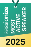
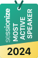
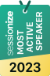
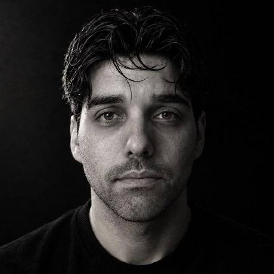

<!-- _class: lead -->
<!-- _paginate: false -->

# De código a Foundry

## Infraestructura de agentes con Aspire

**Emiliano Montesdeoca del Puerto**<br>
Global AI Night 2026 · 12 de noviembre · en línea

<!--
TIEMPO: 0:00 – 0:30

Abrir con una promesa: desarrollar y depurar en nuestro equipo usando recursos reales de Azure,
y después desplegar los mismos agentes en Foundry. Aspire conecta código e infraestructura.
-->

---

<!-- _class: bio -->

## Soy Emi

<div class="bio-layout">
  <div class="bio-copy">
    <p><strong>Cloud Solutions Team Lead</strong><br>Intelequia Technologies</p>
    <p>x5 <strong>Microsoft MVP</strong><br>Developer Technologies </p>
    <p><strong>Marido</strong> y <strong>papá</strong> de las más hermosas.</p>
    <p><strong>Uruguayo</strong>, muy canario.</p>
    <div class="bio-badges">
      
      
      
      
    </div>
  </div>
  
</div>

<!--
TIEMPO: 0:30 – 1:30

Presentación breve: qué haces, el trabajo con cloud e IA y los años como MVP.
-->

---

<!-- _class: lead -->
<!-- _paginate: false -->

# ¿Qué componentes forman una aplicación?

<!--
TIEMPO: 1:30 – 1:40

Plantear la pregunta y dejar unos segundos de silencio. La siguiente slide ofrece una respuesta visual.
-->

---

<!-- _class: problem -->

<div class="scatter">
  <span>App en local</span>
  <span>Modelos en el portal</span>
  <span>URLs y endpoints</span>
  <span>API keys</span>
  <span>Permisos</span>
  <span>Docker</span>
  <span>Deploy</span>
  <span>Logs y trazas</span>
  <span>Suscripción</span>
  <span>Región y cuota</span>
  <span>Variables</span>
  <span>Registry</span>
  <span>Scripts</span>
  <span>Puertos</span>
  <span>Credenciales</span>
  <span>Entornos</span>
  <span>Conexiones</span>
  <span>Health checks</span>
</div>

<!--
TIEMPO: 1:40 – 2:30

Presentar la nube como respuesta. Dejar que reconozcan su día a día y preguntar: «¿Os suenan todas estas cajas?».
Contar el recorrido: elegir suscripción y región, encontrar una URL, configurar credenciales,
arrancar la app, averiguar por qué no conecta y repetir parte del trabajo al desplegar.
No leer todas las cajas ni resolverlas todavía.
-->

---

<!-- _class: visual -->

## Crear servicios era fácil. Conectarlos, no.

<p class="visual-intro">Puertos, URLs, variables y orden de arranque: todo se coordinaba a mano.</p>

<div class="visual-layout">
  <div class="visual-copy">
    <p><strong>Crear:</strong> levantar cada proceso por separado.</p>
    <p><strong>Conectar:</strong> copiar puertos y endpoints a la configuración.</p>
    <p><strong>Arrancar:</strong> coordinar el orden y las dependencias.</p>
    <p><strong>Depurar:</strong> buscar errores entre procesos y logs.</p>
    <p><strong>Repetir:</strong> volver a alinear todo al cambiar de entorno.</p>
  </div>
  <div class="diagram">
    <div class="diagram-node primary">Aplicación</div>
    <div class="diagram-arrow">↓</div>
    <div class="diagram-pair">
      <div class="diagram-node">Puertos<br><small>¿dónde escucha?</small></div>
      <div class="diagram-node cyan">URLs<br><small>¿a qué endpoint?</small></div>
    </div>
    <div class="diagram-arrow">↓</div>
    <div class="diagram-node orange">Configuración dispersa</div>
    <div class="diagram-note">.env · scripts · Docker · portal · README</div>
  </div>
</div>

<p class="metric">Si una pieza cambiaba, tocaba perseguir el mapa de nuevo.</p>

<!--
TIEMPO: 2:30 – 3:00

Contar la rutina: arrancar servicios por separado, asignar puertos, copiar URLs y endpoints
a la configuración, y repetir el montaje al cambiar de entorno. El mapa vivía repartido entre
.env, scripts, Docker, el portal y la memoria del equipo.
Cerrar: «El reto no era crear cada servicio, sino coordinar el conjunto». Pasar a Aspire como
una forma de describir ese sistema desde un solo lugar.
-->

---

<!-- _class: visual -->

## Una aplicación completa. Un mismo flujo de desarrollo. El mismo punto de partida.

<p class="visual-intro">Aspire coordina servicios locales y recursos de Azure desde el AppHost.</p>

<div class="visual-layout">
  <div class="visual-copy">
    <p><strong>Desarrolla:</strong> el playground y los agentes corren como procesos locales.</p>
    <p><strong>Orquesta:</strong> el AppHost declara cómo se conectan y de qué dependen.</p>
    <p><strong>Observa:</strong> el dashboard reúne estado, URLs, logs y trazas.</p>
  </div>
  <div class="diagram">
    <div class="diagram-node primary">AppHost · Aspire<br><small>define y coordina el sistema</small></div>
    <div class="diagram-arrow">↓</div>
    <div class="diagram-pair">
      <div class="diagram-node">En local<br><small>playground · agentes</small></div>
      <div class="diagram-node cyan">En Azure<br><small>Foundry · proyecto · modelos</small></div>
    </div>
    <div class="diagram-note">Aspire conecta los procesos locales con sus dependencias en Azure.</div>
  </div>
</div>

<p class="metric">Desarrollar en local. Aspire orquesta el sistema completo.</p>

<!--
TIEMPO: 3:00 – 4:00

La demo se centra en el ciclo de desarrollo y la orquestación con Aspire, no en el framework
interno de los agentes. El AppHost describe los procesos locales, sus dependencias y los recursos
de Foundry en Azure. Con `aspire run`, el playground y los agentes se ejecutan en local; el
dashboard centraliza URLs, estado, logs y trazas. Después revisaremos el Bicep generado y
desplegaremos la infraestructura: en este ejemplo, Aspire no aloja los agentes en Azure.
-->

---

<!-- _class: visual -->

## Aspire

<p class="visual-intro">Describe la aplicación y sus dependencias; trabaja con ellas desde un mismo sitio.</p>

<div class="visual-layout">
  <div class="visual-copy">
    <p><strong>AppHost.cs</strong> declara recursos, dependencias y referencias.</p>
    <p><code>WithReference</code> suministra endpoints y configuración.</p>
    <p><code>WaitFor</code> espera a las dependencias antes de arrancar.</p>
    <p><strong>Dashboard:</strong> URLs, estado, logs y trazas para depurar.</p>
  </div>
  <div class="diagram">
    <div class="diagram-node primary">AppHost.cs<br><small>modelo de la aplicación</small></div>
    <div class="diagram-arrow">↓</div>
    <div class="diagram-pair">
      <div class="diagram-node">Azure<br><small>Foundry · proyecto · modelos</small></div>
      <div class="diagram-node cyan">Tu equipo<br><small>agentes · playground</small></div>
    </div>
    <div class="diagram-arrow">↓</div>
    <div class="diagram-node">Dashboard<br><small>estado · logs · trazas</small></div>
  </div>
</div>

<!--
TIEMPO: 4:00 – 5:30

Aspire no es el runtime del agente: describe qué recursos hay y qué necesita cada servicio.
En desarrollo, conviven procesos locales y recursos reales de Azure.
Las referencias suministran endpoints y nombres de despliegue como configuración;
no hay que copiarlos a mano entre el portal y cada servicio. El dashboard permite abrir URLs
y seguir una petición sin ir saltando entre consolas.
-->

---

<!-- _class: visual -->

## Microsoft Foundry

<p class="visual-intro">La plataforma de Azure donde desplegamos y consumimos los modelos.</p>

<div class="visual-layout">
  <div class="visual-copy">
    <p><strong>Proyecto:</strong> agrupa los modelos y expone una API.</p>
    <p><strong>Despliegues independientes:</strong> uno para texto y otro para imágenes, cada uno con su modelo y versión.</p>
    <p><strong>Los agentes</strong> llaman a esa API desde tu equipo.</p>
    <p><strong>Preparación:</strong> región, cuota y permisos de la suscripción.</p>
    <p><strong>Identidad y roles:</strong> acceso sin claves compartidas.</p>
  </div>
  <div class="diagram">
    <div class="diagram-node primary">project-globalainight</div>
    <div class="diagram-arrow">↓</div>
    <div class="diagram-pair">
      <div class="diagram-node">chat-globalainight<br><small>texto</small></div>
      <div class="diagram-node orange">image-globalainight<br><small>generación de imagen</small></div>
    </div>
    <div class="diagram-arrow">↓</div>
    <div class="diagram-node cyan">Responses API<br><small>la llaman los agentes</small></div>
    <div class="diagram-note">Entra ID · sin API keys</div>
  </div>
</div>

<!--
TIEMPO: 5:30 – 7:00

Foundry es la parte de IA de esta infraestructura, no una explicación aparte del flujo.
Aquí lo usamos solo para los modelos: los agentes son procesos normales que llaman a la
Responses API del proyecto. La autenticación va con Entra ID (az login en local), sin repartir API keys.
-->

---

<!-- _class: visual -->

## Cada pieza en su sitio

<div class="visual-layout">
  <div class="visual-copy">
    <p><strong>AppHost:</strong> proyecto, modelos y conexiones declarados en código.</p>
    <p><strong>Agenda:</strong> recibe el proyecto y el modelo de chat.</p>
    <p><strong>Carteles:</strong> añade el modelo de imágenes.</p>
    <p><strong>Los agentes leen la configuración;</strong> no necesitan conocer Aspire.</p>
  </div>
  <div class="diagram">
    <div class="diagram-node primary">AppHost · Aspire</div>
    <div class="diagram-arrow">↓</div>
    <div class="diagram-node">Proyecto de Foundry · Azure</div>
    <div class="diagram-pair">
      <div class="diagram-node">Chat</div>
      <div class="diagram-node orange">Imágenes</div>
    </div>
    <div class="diagram-arrow">↓</div>
    <div class="diagram-pair">
      <div class="diagram-node cyan">Agenda<br><small>proyecto + chat</small></div>
      <div class="diagram-node orange">Carteles<br><small>proyecto + chat + imágenes</small></div>
    </div>
    <div class="diagram-note">Agentes en tu equipo · modelos en Foundry</div>
  </div>
</div>

<!--
TIEMPO: 7:00 – 8:30

Enseñar el AppHost una sola vez: recursos de Azure, referencias y WaitFor.
La agenda no recibe el modelo de imágenes. Los agentes solo leen variables de entorno:
el endpoint del proyecto y los nombres de despliegue de los modelos.
-->

---


<!-- _class: demo -->

## Demo 1 · Desarrollar en local

```bash
cd src
aspire run
```

**Agentes en tu equipo · modelos en Azure**

Dashboard → `playground-globalainight` → pruebas y trazas

<!--
TIEMPO: 9:00 – 20:00

Antes de la charla, deja Foundry y los modelos provisionados, inicia sesión con az login y
ten el dashboard listo. En directo:
1. Distinguir procesos locales y recursos de Azure en Resources.
2. Abrir la URL del playground desde el dashboard y ver la configuración que recibe un agente.
3. Probar una recomendación y pedir un cartel; abrir la imagen generada.
4. Seguir la petición en las trazas, desde el agente hasta el modelo y la herramienta.

El foco es el ciclo de desarrollo y depuración, no la calidad del cartel ni el prompt.

Si la generación tarda, abrir Traces mientras espera. Si falla, reproducir el vídeo de respaldo.
-->

---

<!-- _class: demo -->

## Demo 2 · Revisar la infraestructura

```bash
aspire publish -o infra
```

**Bicep generado:** Foundry · proyecto · modelos

<!--
TIEMPO: 20:00 – 26:00

Volver a las declaraciones del AppHost y abrir el Bicep generado: cuenta de Foundry
(disableLocalAuth), proyecto y despliegues de modelos. Los agentes y el playground solo existen
en aspire run, así que no aparecen aquí. Conectar lo que usamos en local con la infraestructura que se revisa
junto al código. Elegir un fichero durante el ensayo; no explicar cada propiedad.
Si vamos tarde, contar el resultado sin recorrerlo.
-->

---

<!-- _class: demo -->

## Demo 3 · Desplegar

```bash
aspire deploy
```

**El mismo AppHost → Foundry · proyecto · modelos en Azure**

<!--
TIEMPO: 26:00 – 32:00

Breve. Lanzar el deploy (por ejemplo, contra otro grupo de recursos) y enseñar el progreso:
crea la misma cuenta de Foundry, el proyecto y los modelos que usamos en local.
Los agentes no se despliegan: siguen siendo procesos que llaman a la API del proyecto.
Cómo alojarlos (App Service, Container Apps…) es otra decisión, fuera de esta charla.

Si tarda, no esperar: enseñar el grupo de recursos ya desplegado en el portal.
-->

---

## Del desarrollo al despliegue

- **En local:** URLs, configuración y trazas desde Aspire.
- **En el repositorio:** Foundry, proyecto y modelos junto al código.
- **En Azure:** la misma infraestructura con `aspire deploy`, sin clics en el portal.

<!--
TIEMPO: 32:00 – 35:00

Volver a la pregunta de las cajas: no desaparecen la suscripción, los permisos ni los modelos;
lo que cambia es cómo los conectamos y cómo trabajamos con ellos.
Aspire une el ciclo de desarrollo con la infraestructura y Foundry aporta los modelos.
Terminar el contenido en el minuto 35.
-->

---

<!-- _class: closing -->
<!-- _paginate: false -->

# Gracias

## ¿Preguntas?

**Emiliano Montesdeoca**<br>
linkedin.com/in/emimontesdeoca · @emimontesdeocaa

**Repo:** [github.com/emimontesdeoca/foundry-aspire-global-ai-night-2026](https://github.com/emimontesdeoca/foundry-aspire-global-ai-night-2026)

<!--
TIEMPO: 35:00 – 40:00

Dejar esta slide durante las preguntas.
-->
